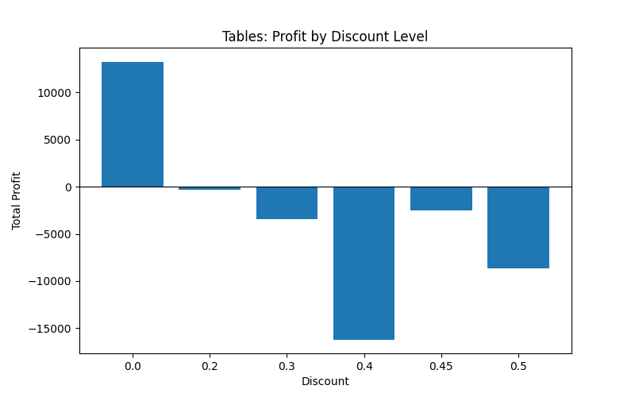
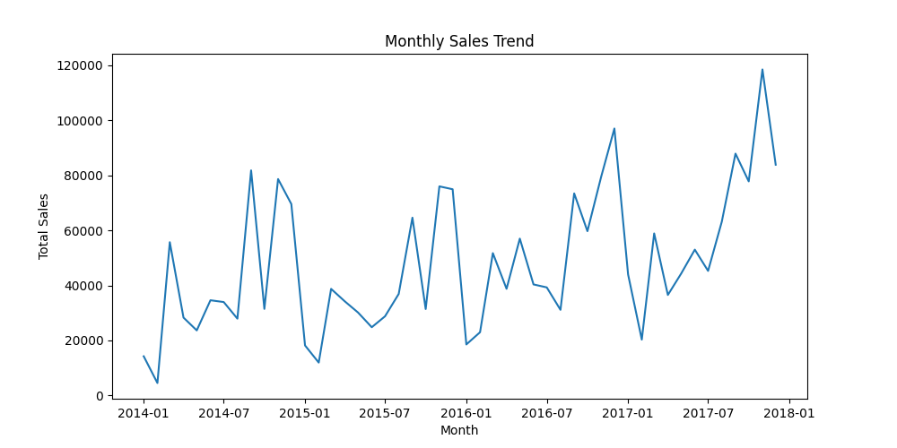
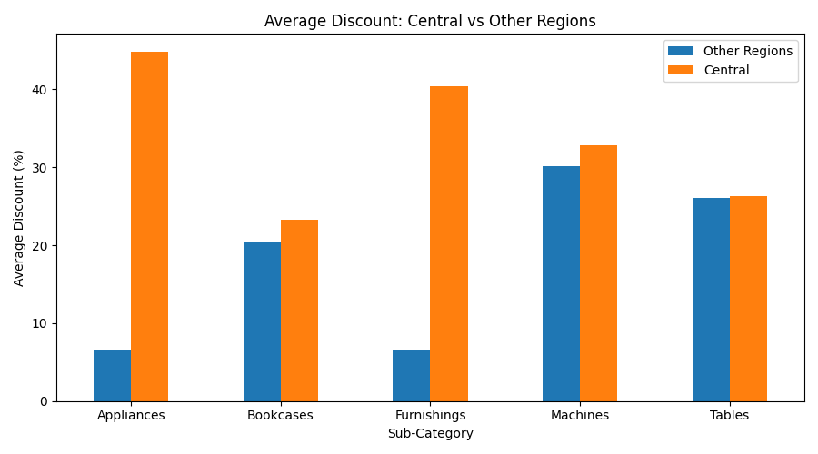

# Superstore Sales Analysis

**Live demo:** https://sales-analysis-dk92aqhg2erba6kforfjo6.streamlit.app/

Data analysis project using Python (pandas, NumPy, Matplotlib, Streamlit) on the Superstore sales dataset (9,994 rows, 21 columns), with an interactive dashboard.

## Data Cleaning
- Checked for missing values and duplicate rows (none found)
- Converted `Order Date` and `Ship Date` from text to datetime
- Stripped extra whitespace from text columns
- Saved the cleaned data to `clean_superstore.csv`

## Key Metrics
- Total Sales: 2,297,200.86
- Total Profit: 286,397.02
- Profit Margin: 12.47%
- Number of Orders: 5,009

## Key Findings
1. **Furniture** has high sales but only about 2.5% profit margin, driven by losses in Tables and Bookcases.
2. **Tables** are profitable with no discount (+13,276) but lose money at every discount level of 30% or more (about -30,700 combined).
3. **Seasonality:** September to December generate about 52% of total sales; January and February are the weakest months.
4. **Central region** has the lowest profit margin (7.9%) and the highest average discount (24%).
5. **Appliances and Furnishings** are profitable overall but lose money in Central, where their average discount is about 40-45% compared with about 6.5% elsewhere.
6.  **Outliers (IQR method, NumPy):** about 6% of rows are large losses (604 rows, total -140,327), equal to roughly half of the final total profit. Their average discount is 46.9% versus 13.6% for the other rows, and 81.6% of them had a discount of 30% or more.

Note: these are patterns in the data; the dataset does not explain the reasons behind the discount decisions.

## Charts

## Tools
Python, pandas, NumPy, Matplotlib, Streamlit, PyCharm
